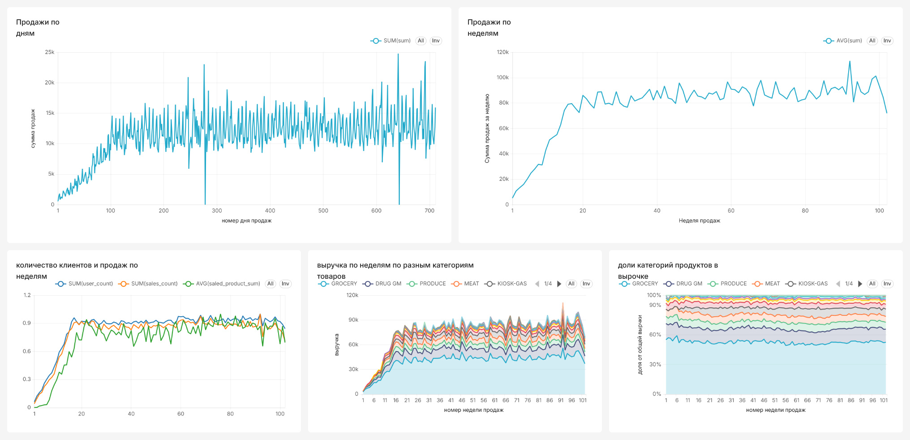
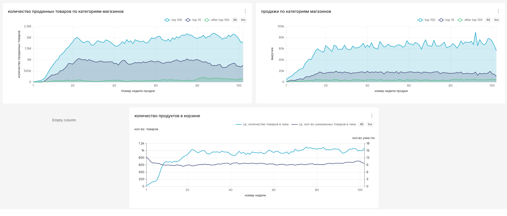
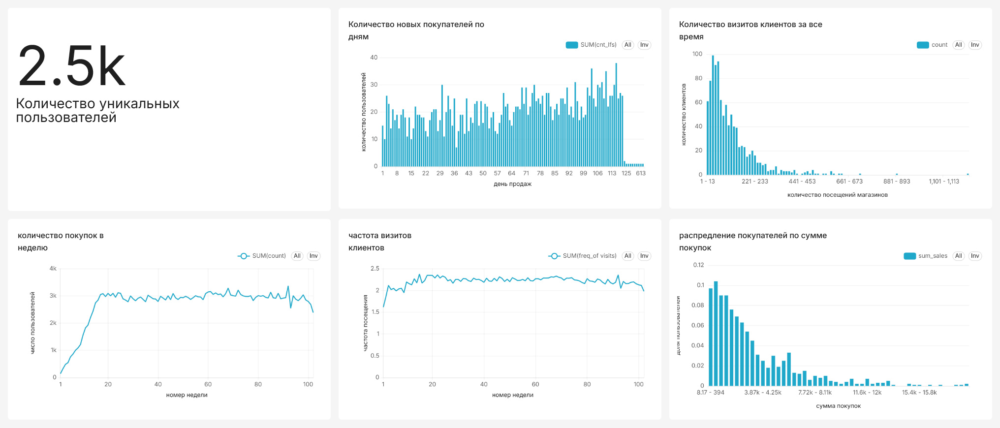

# Анализ розничных продаж

Аналитический проект на данных The Complete Journey

## Цель проекта 

Изучить, что влияет на изменение продаж, как меняется активность покупателей, какие закономерности наблюдваются во время проведения акций

## Данные

датасет (The Complete Journey), который содержит покупки 2500 домохозяйст за два года

## стек

postgres, superset, python

## основные результаты

Продажи

  

  

С начала проведения эксперимента продажи по неделям вырасли в среднем с 83 тыс. \$ до 88 тыс. \$.  
Рост выручки не связан с количеством покупателей или количеством посещений магазинов, рост этих компонент не значителен. За время наблюдений заметен рост количества продаваемых товаров, с чем можно связать рос выручки. Основной прирост количества продаваемы товаров приходится на категорию продуктов питания (groceries). В процентном соотношении рост доли продуктов питания в покупках практически не меняется со временем, что может говорить о росте продаж товаров и других категорий.  
Рост количества продаваемы товаров таже не связан с введением новым магазином. Однако среди разных магазинов динамика отличается: в топ 10 магазинах отсортированных по выручке, количество продаваемых товаров падает и проводт к снижению выручки в этих 10 магазинах. В то 100 магазинах за весь период наблюдений выручка растет, как и количество продаваемых товаров. Оставшаяся часть магазинов имеет вклад около 4% от всей выручки и не влияет на динамику продаж. 
Рост количества продаваемых товаров также связан с количеством уникальных приобретаемых позиций и этот показатель растет на 10% с 8.6 единиц до 9.5 единиц. Растет и количество товаров в одном чеке с 900-950 ед. до 1000-1030 ед. (тут надо указать что клиенты встречаются разные, некоторые покупает единицы или десятки товаров, а некоторые десятками тысяч товаров за раз)

Пользователи

  

Количесто уникальных пользователей - 2500.  
Отслеживаемая группа собралась за первые 100 с небольшим дней наблюдений. За все время эксперимента (102 недели) магазины посетили менее 100 раз 60% клиентов.  
Количество покупок изменяется слабо, среднее количество посещений магазинов с 60 по 100 неделю выроло на 2.6% относительно периода с 20 по 60 неделю. 
А частота визитов клиентов остается практически неизменной и составляет в среднем 2.2 раза в неделю.  

