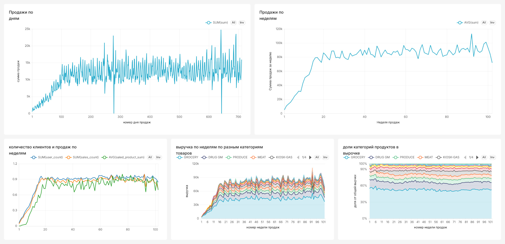
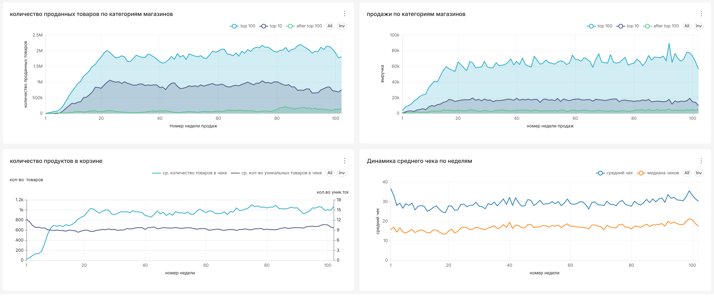
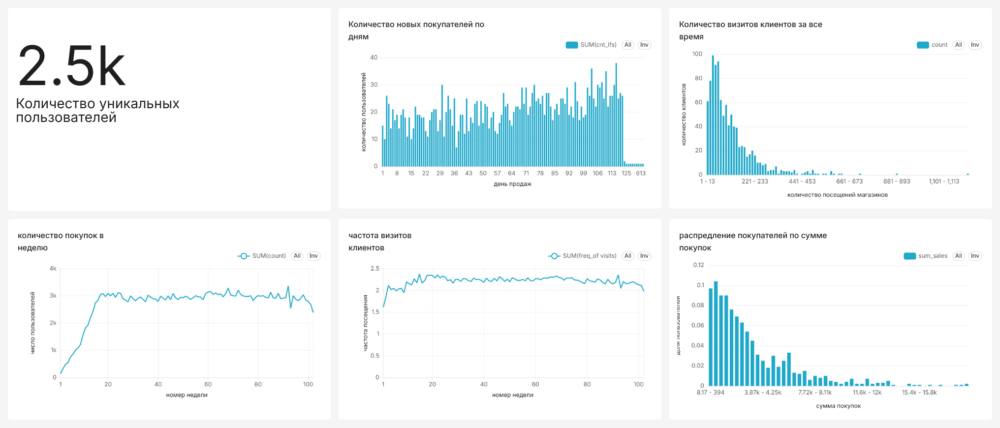
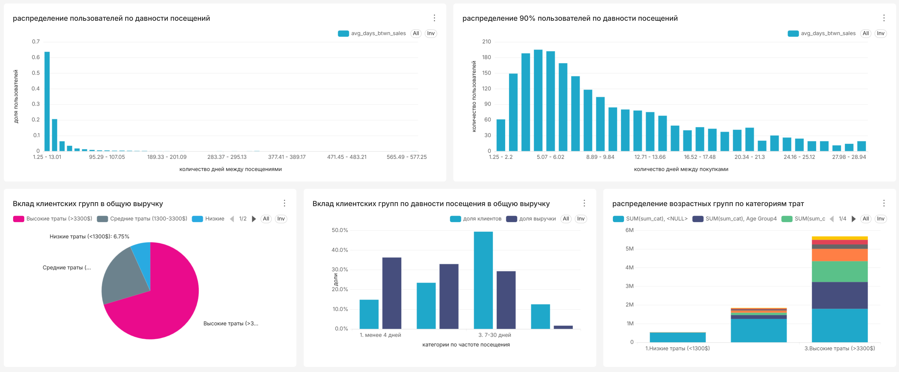
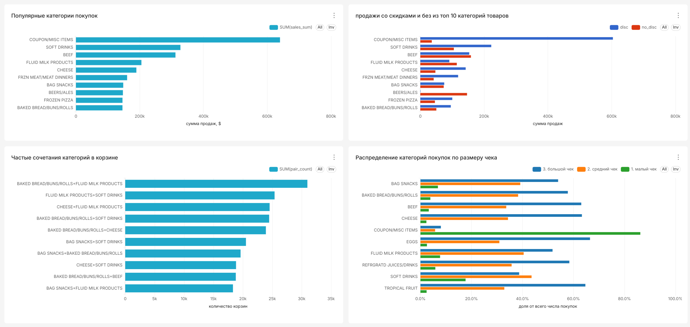
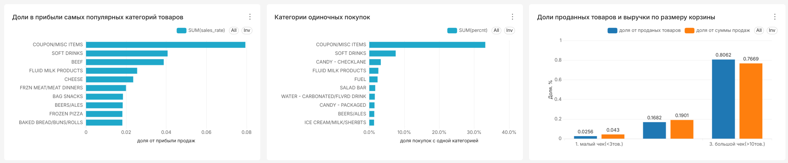

# Анализ розничных продаж

Аналитический проект на данных The Complete Journey

## Цель проекта 

Изучить, что влияет на изменение продаж, как меняется активность покупателей, какие закономерности наблюдваются во время проведения акций

## Данные

датасет (The Complete Journey), который содержит покупки 2500 домохозяйст за два года

## стек

postgres, superset, python

## основные результаты

__Продажи__
--

  

Начальный подьем дневной и недельной выручки связан с началом фиксирования данных. Поэтому первые 20 недель отражают расширение аудитории клиентов. После начального периода в 20 недель выручка стабилизируется и начинает колебаться около среднего уровня, поэтому этот промежуток не используется для сранвнений. Для количественных сравнений выбраны два периода с 20 по 59 и с 60 по 99 недели.

| Показатель | Недели 20–59 | Недели 60–99 | Изменение |
|:--|--:|--:|--:|
| Выручка за период, $ | 3 395 060 | 3 584 543 | +5,58% |
| Выручка в среднем за неделю, $ | 84 876 | 89 613 | +5,58% |
| Активные домохозяйства за период | 2 443 | 2 463 | +0,82% |
| Количество чеков | 117 363 | 119 747 | +2,03% |
| Чеков на активных клиентов | 48,04 | 48,62 | +1,20% |
| Средний чек, $ | 28,93 | 29,93 | +3,48% |
| Среднее кол-во уникальных товаров в чеке | 9,26 | 9,42 | +1,72% |

Начиная с 20 недели проведения эксперимента продажи по неделям вырасли в среднем с 84 тыс. \$ до 88 тыс. \$.  
Рост выручки не связан с количеством покупателей или количеством посещений магазинов, рост этих компонент не значителен. Рост выручки связан с ростом среднего чека, что согласуется с увеличением количества продаваемых товаров. Основной прирост количества продаваемых товаров приходится на категорию продуктов питания (groceries). В процентном соотношении рост доли продуктов питания в покупках практически не меняется со временем, что может также говорить о росте продаж товаров и других категорий.  

  

Рост количества продаваемы товаров таже не связан с введением новым магазином. Однако среди разных магазинов динамика выручки отличается: в топ 10 магазинах по выручке, количество продаваемых товаров падает и приводит к снижению выручки в этих 10 магазинах. В топ 100 магазинах за весь период наблюдений выручка растет, как и количество продаваемых товаров. Оставшаяся часть магазинов имеет вклад около 4% от всей выручки и не влияет на динамику продаж. 
Рост количества продаваемых товаров также связан с количеством уникальных приобретаемых позиций и этот показатель растет с 9.26 единиц до почти 9.5 единиц. Растет и количество товаров в одном чеке с 900-950 ед. до 1000-1030 ед. (тут надо указать что клиенты встречаются разные, некоторые покупает единицы или десятки товаров, а некоторые десятками тысяч товаров за раз и в среднем получается порядок $10^3$)

__Пользователи__
--

  

Количесто уникальных пользователей - 2500.  
Отслеживаемая группа собралась за первые 100 с небольшим дней наблюдений. За все время эксперимента (102 недели) магазины посетили менее 100 раз 60% клиентов.  
Количество покупок изменяется слабо, среднее количество посещений магазинов с 60 по 100 неделю выроло на 2.6% относительно периода с 20 по 60 неделю. 
А частота визитов клиентов остается практически неизменной и составляет в среднем 2.2 раза в неделю (частота 2.2 относится к активным клиентам за неделю, среди всех кличентов частота будет 1.2).  

  

Графики выше описывают средний интервал между днями покупок. Этот показатель считается между покупками активных покупателей.  
У 90% клиентов средний интервал между покупками менее 30 дней.

| Средний интервал между днями покупок | Клиенты | Доля аудитории | Доля выручки |
|--|--:|--:|--:|
| Менее 4 дней | 370 | 14,80% | 36,21% |
| От 4 до менее 7 дней | 585 | 23,40% | 32,89% |
| От 7 до менее 30 дней | 1 233 | 49,32% | 29,26% |
| 30 дней и более | 309 | 12,36% | 1,63% |

Клиенты покупающие чаще 1го раза в неделю составляют 38,2% всей аудитории и приносят около 69,1% выручки.

__Товары__
--

Рейтинг товаров по принесенной выручке показывает наименования товаров приносящих наибольшую выручку. Безалкогольные напитки приносят 283 тыс. \$ и встречаются в 61 916 чеках, говядина приносит 269 тыс. \$ и вмтречается в 31 619 чеках, молочные продукты приносят 173,68 тыс. \$ и вмтречается в 59 211 чеках.

График с продажами по скидкам и без показывает вклад в выручку от продаж соответствующих продуктов. И показывает, что иссловать влияние акций следует внутри отдельных категорий, потому что спрос на некоторые товары такие как (говядина, молоко) одинаков в промежутки времени как со скидками так и без и выручку приносят они сопоставимую. а товары такие как сыр и безалкогольные напики приносят больше во время акций.  
Наиболее частыми сопутствующими товарами в чеке являются хлеб и молоко. Оба этих товара встречаются в 31 тыс. чеках из 276 484, то есть в 11% всех покупок, а по отдельности один из этих товаров есть в 104 тыс. чеков или 37,6% всех покупок. 

  

  

Наиболее частые позиции покупок с одной категорией товаров показывают, что наполнение таких корзин отличается от покупок с большим числом категорий товаров.   
Но количество покупок с одной категорией мало по отношению ко всему числу покупок и составляет менее 10%.

__Синтетический А/В тест__
--

В [ноутбуке](src/ab_test.ipynb) реализованы: t-тест независимых выборок, тест Манна-Уитни,
а также воспроизводимое разделение пользователей с помощью SHA256 и salt

Выборки считаются независимыми в рамках этой задачи  
Уровень значимости = 0.05  
альтернативные гипотезы двусторонние

### 1. Акционные товары кампании №8

В качестве тестовой группы выбраны участники акции №8, а в качестве контрольной группы эти же участники в период до проведения акции №8  
Используемая метрика - среднее количество проданных акционных товаров за день  

Среднее значение метрики до акции = 7.35 и 7.16 во время акции  
Статистически значимого различия не обнаружено:
- p-value t-теста = 0.273
- p-value теста Манна-Уитни = 0.410

### 2. Средний денежный чек

В качестве группы А выбраны участники делавшие покупки с 21 по 60 недели  
В качестве группы В выбраны участники делавшие покупки с 61 по 100 недели  
Используемая метрика - средний чек

| Вариант сравнения | Средний чек A | Средний чек B | Изменение | p-value t-теста |
|--|--:|--:|--:|--:|
| Все покупатели | 27.31 | 28.40 | +4% | 4.77 × $10^{-18}$ |
| Непересекающиеся группы пользователей, назначенные через SHA-256 и salt | 28.82 | 30.24 | +4.95% | 1.81 × $10^{-11}$ |

В обоих вариантах средний чек группы B статистически выше, чем в группе А
